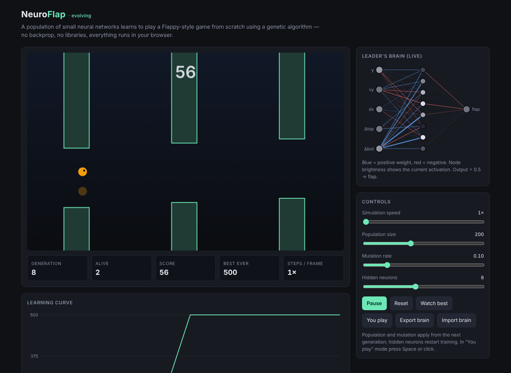

# NeuroFlap — Neuroevolution in the Browser

A population of small neural networks learns to play a Flappy-style game **from scratch** with a **genetic algorithm**. No backpropagation, no ML libraries, no build step: a single HTML file in vanilla JavaScript.

**▶ Live demo:** `https://<your-username>.github.io/neuroflap/`



## What it does
- Every agent is a feed-forward neural network: **5 inputs → N hidden (tanh) → 1 output (sigmoid)**.
- Agents that survive longer and pass more pipes score a higher **fitness**.
- Each generation, **elitism + tournament selection + uniform crossover + Gaussian mutation** produce the next population.
- With the default settings it typically **masters the game (500 pipes) in about 5–10 generations**.

## Features
- Live **network visualization** of the leading agent (weights and activations)
- **Learning curve** (best and average score per generation)
- Adjustable speed (up to 100×), population size, mutation rate, and hidden-layer size
- **Watch best** mode: replay the best brain found so far
- **You play** mode: try to beat the AI yourself
- **Export / Import** of trained brains as JSON

## Network inputs
| Input | Meaning |
|---|---|
| `y` | Agent's height (normalized) |
| `vy` | Vertical velocity |
| `dx` | Horizontal distance to the next pipe |
| `Δtop` | Vertical distance to the top of the gap |
| `Δbot` | Vertical distance to the bottom of the gap |

## Fitness function
```
fitness = frames_survived + 150 × pipes_passed + 30 × (1 − |y − gap_center| / H)
```
The last term breaks ties early in training by rewarding agents that died close to the gap.

## Running it
Open `index.html` in a browser. To publish it on GitHub Pages: Settings → Pages → Branch: `main` / root.

## Tech
Vanilla JavaScript, Canvas 2D, and a neural network + genetic algorithm written from scratch (~400 lines).

## Possible extensions
- NEAT (evolving the network topology as well)
- A comparison with reinforcement learning (DQN / PPO)
- Increasing difficulty (moving pipes, a narrowing gap)
